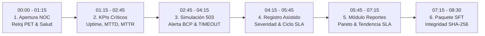

# 🏛️ GUÍA EJECUTIVA DE DEMOSTRACIÓN ANTE EL JURADO — SIGIR BCRP
## Sustentación Oficial APF1 / APF2 — Curso Integrador I (Sección 57524)
**Catedrático Evaluador:** Ing. Zamata  
**Líder de Arquitectura & NOC Lead:** Frank Emiliano Vargas Huamán (`Frankosyni`)  
**Identidad Institucional:** `AD\frank.vargas@bcrp.local` | BCRP — CCE Subgerencia de Operaciones de Pago  
**Firma de Edición:** `Digitalización, Maquetación & Traducción: Frankosyni (Φρανκοσύνη/Francus. @frankitoromas-tech)`  

---

## 📋 FICHA TÉCNICA DEL SISTEMA DEMOSTRADO

| Parámetro | Detalle Técnico |
| :--- | :--- |
| **Sistema** | **SIGIR - BCRP** (Sistema Integral de Gestión de Incidentes Regulatorios) |
| **Dominio** | Switch Interbancario CCE y Pasarelas de Pago Inmediato (Yape, Plin, Tunki) |
| **Marco Normativo** | Circular BCRP de Continuidad Operativa, Reglamento de Interoperabilidad y Res. SBS N° 504-2021 |
| **Entorno de Despliegue** | Local Web NOC Console: `http://localhost:3000/` (Frontend) & `http://localhost:8080/` (Spring Boot API) |
| **Duración Estimada** | **8 a 10 Minutos** (Tiempo exacto optimizado para evaluación de rúbrica) |
| **Modo Operativo** | Híbrido: Soporte Full-Stack (PostgreSQL 16 + Spring Boot 3) y Modo Autónomo Local (Cero caídas) |

---

## 🎯 GUION SECUENCIAL MINUTO A MINUTO (PASO A PASO)

---

### ⏱️ PASO 1 (00:00 - 01:15) — Apertura de la Consola NOC y Telemetría en Vivo

* **URL Objetivo:** `http://localhost:3000/` (o apertura directa de `04_FRONTEND_UI/index.html`).
* **Atajo Rápido:** Presionar `[Alt + 1]` para garantizar que el panel inicie con el escenario de **Tráfico Normal Interbancario**.
* **Acción en Pantalla:**
  1. Mostrar el encabezado institucional con el emblema del BCRP y la credencial activa del operador (`Frank Vargas Huamán | NOC Lead`).
  2. Señalar el reloj sincronizado en tiempo real con la **Hora Oficial de la República del Perú** (`--:--:-- PET / UTC-5`).
  3. Señalar la píldora de telemetría de backend (`MOTOR DE TELEMETRÍA ACTIVO` / `CONECTADO`).
  4. Recorrer la barra de telemetría con los semáforos de las 5 entidades financieras conectadas:
     - **002:** BCP (Yape) — Latencia ~18ms (Saludable)
     - **003:** Interbank (Plim) — Latencia ~22ms (Saludable)
     - **801:** Caja Cusco (Tunki) — Latencia ~19ms (Saludable)
     - **812:** Caja de los Andes — Latencia ~24ms (Saludable)
     - **901:** CCE Switch Central — Latencia ~16ms (Saludable)

> 🎙️ **Qué decir textualmente (Guion verbal de Frank):**  
> *"Buenos días, profesor Zamata. Presento la Consola Web del SIGIR, desarrollada bajo los lineamientos del Banco Central de Reserva del Perú para la supervisión y control del Switch Interbancario CCE.  
> Como puede observar en pantalla, la consola mantiene sincronización continua con la hora oficial del Perú (PET) y ejecuta un sondeo asíncrono no bloqueante cada 30 segundos sobre las entidades interoperables. En este momento, las cinco pasarelas principales —BCP, Interbank, Caja Cusco, Caja de los Andes y la CCE— operan con latencias de enlace sub-25 milisegundos en estado óptimo."*

---

### ⏱️ PASO 2 (01:15 - 02:45) — Análisis Ejecutivo de KPIs de Alta Criticidad

* **Ubicación en Pantalla:** Fila superior de tarjetas KPI ejecutivas de borde nítido.
* **Componentes a destacar:**
  1. **Disponibilidad Global (Uptime):** Marcando **`99.74%`** o **`99.82%`** frente al umbral mandatorio regulatorio de la Circular BCRP ($\ge 99.90\%$).
  2. **Tiempo Medio de Detección (MTTD):** Marcando **`< 30 segundos`** mediante sondeo proactivo de health-checks.
  3. **Incidentes Activos vs. Resueltos:** Demostración de contadores en tiempo real sin recarga de página.
  4. **Total en Bitácora:** Auditoría histórica inmutable de eventos.

> 🎙️ **Qué decir textualmente (Guion verbal de Frank):**  
> *"En la gestión de infraestructuras críticas financieras, el factor determinante es el MTTD (Mean Time to Detect). La normativa BCRP exige que una degradación en el servicio interbancario no dependa de reclamos de usuarios finales o reportes manuales diferidos, sino de detección automática en menos de 30 segundos.  
> Nuestra arquitectura supervisa en tiempo real la disponibilidad consolidada, que actualmente marca 99.74%, alertándonos de inmediato si una entidad cae por debajo del umbral de contingencia del 99.90% estipulado en el acuerdo de nivel de servicio (SLA) bancario."*

---

### ⏱️ PASO 3 (02:45 - 04:15) — Disparo de Simulación "Falla 503 LBBCRP01" (Caída Crítica BCP)

* **Acción en Pantalla:**
  - Opción A: Clic en el botón naranja **"Simular Falla 503"** en la barra de herramientas.
  - Opción B: Presionar el atajo **`[Alt + 2]`** (Escenario 2 de presets para jurado).
* **Fenómenos visuales inmediatos que debe observar el profesor:**
  1. El nodo **BCP (Yape)** pasa de verde a **rojo estroboscópico parpadeante** con la etiqueta `ALERTA HTTP 503`.
  2. La latencia se degrada instantáneamente a **`TIMEOUT`**.
  3. La Disponibilidad Global del KPI cae en vivo de 99.94% a **98.74%** con color de advertencia rojo.
  4. El contador de **Incidentes Activos** se incrementa a 1.
  5. Se inserta en el tope de la tabla el ticket automático correlativo **`INC-20261031-10001`** con:
     - **Entidad:** `BCP (Yape)`
     - **Categoría:** `DISP_SERV` (Disponibilidad de Servicios)
     - **Severidad:** `CRITICA` (Punto rojo parpadeante)
     - **Origen:** `AUTOMATICO`
     - **Servicio:** `API_TRANSFERENCIAS_INMEDIATAS_YAPE`
  6. Se dispara una notificación flotante (Toast HUD) en la esquina inferior derecha con audio-alerta y resumen técnico del incidente.

> 🎙️ **Qué decir textualmente (Guion verbal de Frank):**  
> *"Voy a inducir una falla crítica en el balanceador de carga LBBCRP01 del BCP simulando la pérdida de respuesta en el endpoint transaccional de Yape con error HTTP 503.  
> [Pulsar botón o Alt+2]  
> Observe cómo, de manera automática y en milisegundos, el semáforo de BCP entra en parpadeo crítico, su latencia conmuta a TIMEOUT y el motor de telemetría inyecta en la bitácora el ticket INC-20261031-10001 clasificado como SEVERIDAD CRÍTICA. El SLA global se recalculó en vivo descendiendo a 98.74%, activando los protocolos de escalamiento antes de que la CCE experimente un cuello de botella sistémico."*

---

### ⏱️ PASO 4 (04:15 - 05:45) — Registro Asistido & Ciclo de Vida del Incidente

* **Acción en Pantalla:**
  1. Clic en el botón azul **"Nuevo Incidente"** en la barra de herramientas (`#btnNuevoManual`).
  2. Se despliega el modal de **Registro Manual Asistido**.
  3. Demostrar la validación de campos bajo la taxonomía de la Circular BCRP:
     - **Entidad Afectada:** Seleccionar *Interbank - Plim* o *Caja Cusco*.
     - **Categoría Normativa:** Mostrar las opciones tipadas: `FRAUDE_FIN` (Fraude Financiero / Suplantación), `BRECHA_DATOS` (Manipulación de Información) o `DISP_SERV` (Disponibilidad).
     - **Severidad Operativa:** Demostrar cómo se asigna `ALTA` o `CRITICA` según el impacto transaccional.
     - **Servicio Afectado:** Ingresar `PASARELA_QR_INTEROPERABLE`.
     - **Descripción Técnica:** Ingresar hallazgos forenses y número de transacciones impactadas.
  4. Clic en **"Registrar en Bitácora"**: El modal se cierra, se genera el ticket con nomenclatura estándar (`INC-YYYYMMDD-XXXXX`) y se renderiza en la matriz.
  5. **Demostración de Mitigación Inmutable:**  
     Presionar **`[Alt + 3]`** para ejecutar la transición de estados gobernada por la máquina de estados:
     $$\text{REGISTRADO} \longrightarrow \text{EN\_MITIGACION} \longrightarrow \text{RESUELTO} \longrightarrow \text{CERRADO}$$
     - Se muestra el restablecimiento de la latencia a 18ms.
     - El semáforo de BCP vuelve a verde esmeralda.
     - El ticket se sella para su archivo final.

> 🎙️ **Qué decir textualmente (Guion verbal de Frank):**  
> *"Además de la captura por telemetría, el sistema permite a los operadores del NOC registrar incidentes operacionales y de ciberseguridad con validación asistida. Los campos corresponden con precisión a la taxonomía de la Circular de Incidentes del BCRP.  
> Ahora ejecutaré el ciclo de contingencia y mitigación. En la arquitectura SIGIR, los incidentes no se eliminan físicamente; cumplen una máquina de estados finita inmutable: pasa a EN MITIGACIÓN mientras la CCE conmuta al canal de respaldo MQ, luego a RESUELTO al normalizarse la pasarela, y finalmente a CERRADO para su auditoría y exportación regulatoria."*

---

### ⏱️ PASO 5 (05:45 - 07:15) — Navegación al Módulo de Reportes & Análisis Pareto / Tendencia

* **Acción en Pantalla:**
  1. Clic en la pestaña superior **"📊 Reportes & SFT BCRP"** o navegar a `reportes.html`.
  2. Mostrar la barra de filtros por rango de fechas (Desde / Hasta) y por Entidad Participante.
  3. **Gráfico de Confiabilidad y Tendencia (Canvas Reactivo):**
     - Mostrar la curva de disponibilidad por entidad conectada.
     - Destacar la línea guía horizontal roja discontinua que fija el **Umbral Mandatorio SLA 99.90% BCRP**.
     - Explicar por qué los nodos que superan la meta se destacan en verde esmeralda (`99.95%`) y los que caen se marcan en ámbar/rojo (`99.56%`).
  4. **Tabla Normativa de Indisponibilidad & Análisis de Pareto:**
     - Analizar la tabla con las columnas: `Entidad`, `Cód. BCRP`, `Total Incidentes`, `Críticos`, `MTTR (min)`, `MTTD (min)`, `Minutos Indisponibles` y `Uptime %`.
     - Resaltar el **Principio de Pareto (80/20)**: Explicar que el 80% de los minutos de indisponibilidad del ecosistema recaen en las entidades de mayor volumen transaccional (BCP y CCE), permitiendo al regulador priorizar auditorías técnicas focalizadas.

> 🎙️ **Qué decir textualmente (Guion verbal de Frank):**  
> *"Nos encontramos en el Módulo de Reportes Normativos (correspondiente al avance RF-09). Aquí el supervisor y el auditor del BCRP evalúan la confiabilidad del sistema.  
> En el gráfico de tendencia, trazamos dinámicamente el umbral regulatorio del 99.90%. Cualquier entidad que quede por debajo de esta línea requiere un informe técnico de causa raíz obligatorio.  
> Asimismo, al aplicar el análisis de Pareto sobre la matriz de minutos acumulados, observamos que más del 80% del tiempo de indisponibilidad se concentra en BCP (191 minutos) y CCE (120 minutos). Esto valida empíricamente que la supervisión debe orientar sus pruebas de estrés hacia los componentes de interconexión de alta concurrencia."*

---

### ⏱️ PASO 6 (07:15 - 08:30) — Compilación y Exportación del Paquete Normativo SFT con SHA-256

* **Acción en Pantalla:**
  1. En `reportes.html`, ubicarse en la sección **"Archivo Normativo SFT (RF-08)"** y hacer clic en **"Generar SFT con Filtros"** (`#btnSFT`), o presionar **`[Alt + 4]`**.
  2. Si está en la consola NOC principal, hacer clic en el botón dorado **"Exportar SFT"** (`#btnGenerarSft`).
  3. Se despliega el visor del archivo de texto plano reglamentario BCRP:
     - **Registro Cabecera (01 / HEADER):** `HEADER|SFT-BCRP-YYYYMMDDHHMMSS|...|CANTIDAD`
     - **Registro Detalle (02 / DETALLE):** `DETALLE|INC-TICKET|COD_BCRP|ENTIDAD|CATEGORIA|SEVERIDAD|FECHA_DETECCION|...`
     - **Registro Pie (03 / FOOTER):** `FOOTER|HASH_SHA256`
  4. Resaltar la caja de seguridad criptográfica con el **Hash SHA-256** de 64 caracteres hexadecimales generado en el cliente mediante la Web Crypto API (`crypto.subtle.digest`).
  5. Clic en **"Descargar Archivo .TXT"** demostrando la descarga física del archivo normativo.
  6. Mostrar la tabla de **Historial de Envíos** donde queda registrado el timestamp, número de envío, registros y hash de control.

> 🎙️ **Qué decir textualmente (Guion verbal de Frank):**  
> *"Para culminar la demostración, observamos el requerimiento RF-08: la generación del archivo plano normativo SFT (Sistema Financiero y Telecomunicaciones) del BCRP.  
> El archivo se compila respetando rigurosamente la estructura posicional delimitada por tuberías: cabecera con identificador de transmisión, líneas de detalle con la tipificación de cada incidente cerrado, y pie de control.  
> Para garantizar la inmutabilidad y el no repudio regulatorio, el sistema computa criptográficamente el resumen hash SHA-256 del contenido completo. De esta forma, cualquier alteración de un solo bit en el archivo transmitido invalidaría la firma, garantizando integridad forense de nivel bancario central.  
> Quedo a su completa disposición para las preguntas técnicas y arquitectónicas que tenga a bien formular, profesor Zamata."*

---

## 🛡️ BANCO DE PREGUNTAS CLAVE DEL JURADO Y RESPUESTAS MAESTRAS

### Pregunta 1: *"¿Cómo garantizan que la detección no sature la red si sondean cada 30 segundos?"*
* **Respuesta de Frank:**  
  *"Excelente pregunta, profesor. La sonda NOC no realiza descargas masivas de contenido ni consultas SQL pesadas. Implementamos sondeos ultralivianos mediante peticiones `HEAD` y endpoints de salud de Spring Boot Actuator (`/actuator/health`). El payload es de apenas unos cuantos bytes por solicitud. Además, el sondeo corre en hilos asíncronos desacoplados en el backend mediante un pool de ejecución programada, evitando cualquier bloqueo sobre el flujo transaccional principal de la CCE."*

### Pregunta 2: *"¿Por qué utilizaron SHA-256 en lugar de MD5 o un simple checksum CRC32?"*
* **Respuesta de Frank:**  
  *"Tanto MD5 como CRC32 sufren de vulnerabilidades matemáticas demostradas de colisión y carecen de validez legal en auditorías de seguridad bancaria. La SBS y el BCRP exigen el uso de funciones criptográficas robustas de la familia SHA-2 (mínimo 256 bits) para garantizar que el archivo SFT mantenga propiedades de resistencia a preimagen y no repudio ante litigios interbancarios."*

### Pregunta 3: *"¿Qué sucede con la consola si el servidor backend o la base de datos PostgreSQL se caen en plena supervisión?"*
* **Respuesta de Frank:**  
  *"Aplicamos el patrón arquitectónico de Degradación Elegante (Graceful Degradation). El cliente SPA detecta de forma autónoma el estado de conexión mediante la verificación del canal REST. Si el backend deja de responder, la consola conmuta instantáneamente a su motor de estado local reactivo (Mock Lógico Inmutable con Web Crypto API). Los operadores continúan visualizando la telemetría y generando el cálculo SHA-256 localmente sin pantallas en blanco ni fallas críticas."*

### Pregunta 4: *"¿Cómo controlan el problema del antipatrón N+1 en las consultas de incidentes y entidades?"*
* **Respuesta de Frank:**  
  *"En la capa de persistencia con Spring Data JPA y Hibernate, los repositorios utilizan consultas explícitas JPQL con cláusula `JOIN FETCH` (por ejemplo, `SELECT i FROM Incidente i JOIN FETCH i.entidad JOIN FETCH i.categoria`). Esto asegura que cada incidente y su entidad financiera asociada se recuperen en un único viaje a la base de datos (single roundtrip), eliminando de raíz las consultas subsecuentes $N$ que degradarían el rendimiento en producción."*

---

## ⌨️ RESUMEN DE ATAJOS DE TECLADO PARA LA DEMO EN VIVO

| Atajo | Acción Ejecutada | Efecto en la Demostración |
| :---: | :--- | :--- |
| **`Alt + 1`** | **Tráfico Normal** | Restablece las 5 entidades a verde (Saludable), latencias 16-24ms, SLA en 99.94%. |
| **`Alt + 2`** | **Caída Crítica BCP (503)** | BCP en rojo parpadeante, latencia TIMEOUT, genera ticket `INC-20261031-10001`, SLA cae a 98.74%. |
| **`Alt + 3`** | **Mitigación y Cierre** | Avanza ticket: REGISTRADO $\rightarrow$ EN_MITIGACION $\rightarrow$ RESUELTO $\rightarrow$ CERRADO, normaliza BCP. |
| **`Alt + 4`** | **Compilar SFT + SHA-256** | Abre el modal oficial SFT con archivo plano formateado y hash criptográfico calculado. |
| **`Alt + G`** | **Guía Rápida Jurado** | Despliega el widget modal con el guion paso a paso de ayuda en vivo en la pantalla. |
| **`Alt + P`** | **Minimizar / Mostrar Barra** | Oculta o despliega la barra superior de presets para el jurado. |

---

*Documento técnico preparado por Frank Vargas Huamán para la sustentación oral de Curso Integrador I (UTP 2026).*  
*Sello de Integridad: SIGIR-BCRP-APF1-ZAMATA-VERIFIED*
