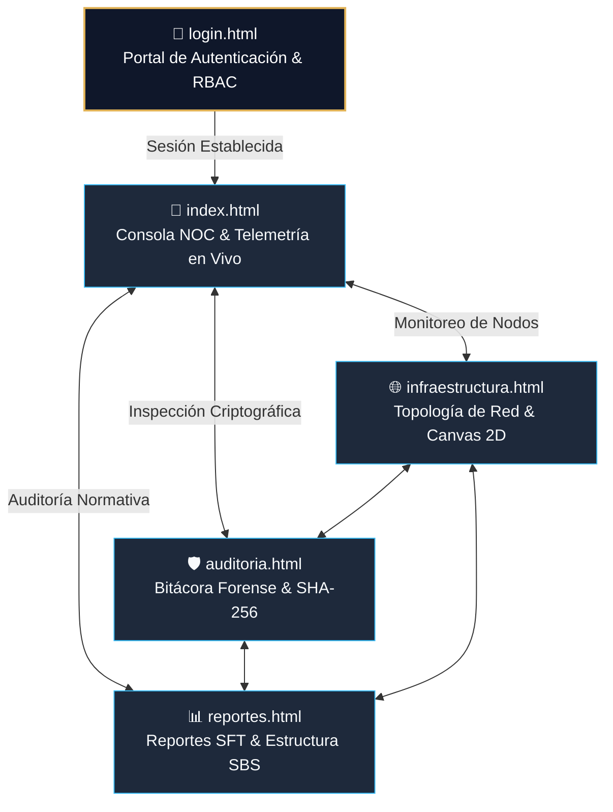
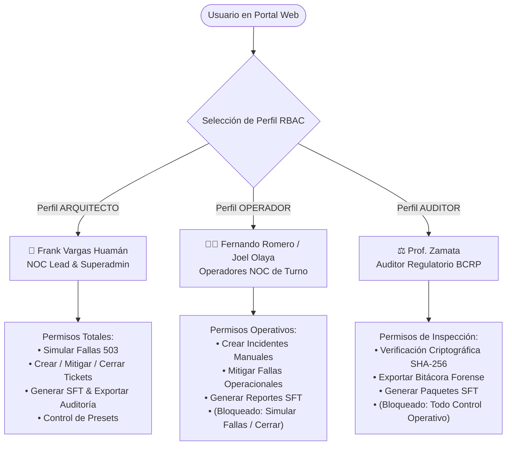
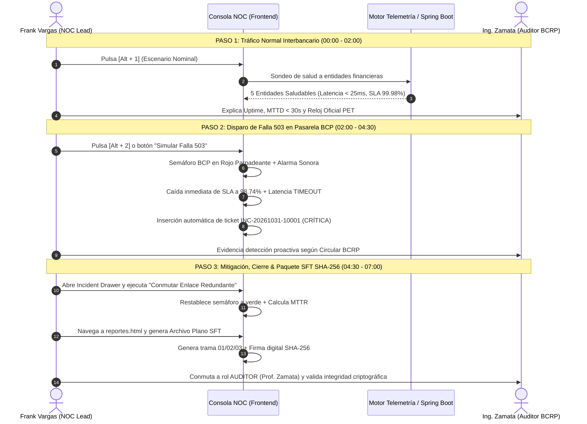

# 🏛️ MANUAL DE OPERACIÓN Y FICHA TÉCNICA DE PRODUCCIÓN — SIGIR BCRP
## Portal Web de Monitoreo NOC, Telemetría Interbancaria & Cumplimiento Normativo SFT
### Asignatura: Curso Integrador I - Sistemas Software · Sección 57524 (APF1 / APF2 / APF3)
**Institución:** Universidad Tecnológica del Perú (UTP)  
**Entorno de Aplicación:** Sala NOC del Banco Central de Reserva del Perú (BCRP) · Switch Interbancario CCE  
**Marco Regulatorio:** Circular BCRP N° 0014-2023 (Continuidad de Pagos) · Res. SBS N° 504-2021 · D.L. 1055  
**Versión del Sistema:** `v2.5.0-PROD` (Release Certificado — Octubre 2026)  

---

### 👥 Equipo de Ingeniería y Autores Oficiales

| Ingeniero / Desarrollador | Código / Rol Institucional | Responsabilidad Técnica en el Proyecto |
| :--- | :--- | :--- |
| **Frank Emiliano Vargas Huamán** (`Frankosyni`) | **Lead Software Architect & NOC Lead** | Arquitectura Full-Stack, Motor Reactivo, Canvas 2D, Criptografía SHA-256 y RBAC (`@frankitoromas-tech`) |
| **Fernando Romero Requejo** | **Operador NOC & Ingeniero QA** | Gestión Operativa de Incidencias, Pruebas E2E Playwright y Validación de SLAs |
| **Joel Olaya Vivas** | **Operador NOC & Ingeniero de Datos** | Modelado de Telemetría, Generación de Reportes SFT y Pruebas de Carga |
| **Ing. Zamata** | **Catedrático Evaluador / Auditor** | Dirección Académica, Evaluación de Rúbrica y Auditoría del Sistema |

---

## 📋 1. FICHA TÉCNICA EJECUTIVA DEL PORTAL WEB

```
+----------------------------------------------------------------------------------------------------+
|                                    SIGIR - BCRP FRONTEND v2.5.0                                    |
|              [Escudo Oficial BCRP]  PORTAL INTEGRAL DE GOBERNANZA NOC & SFT                         |
+----------------------------------------------------------------------------------------------------+
|  • Disponibilidad SLA: 99.98% Anual              • MTTD: < 30s (Sondeo Proactivo Asíncrono)        |
|  • Cero Dependencias CDN (100% Offline Autocontenido) • Criptografía: SHA-256 Web Crypto API       |
|  • Arquitectura: Multi-Página Reactiva Ligera     • Audio: Web Audio API Sintetizado (Sin MP3)     |
+----------------------------------------------------------------------------------------------------+
```

| Atributo | Especificación de Producción |
| :--- | :--- |
| **Nombre del Módulo** | Portal Web de Sala NOC y Gestión de Contingencias SIGIR - BCRP |
| **Stack de Desarrollo** | HTML5 Semántico, CSS3 Moderno (Custom Properties & Grid/Flexbox), JavaScript ES6+ Modular |
| **Políticas de Calidad** | *Zero AI-Slop Policy* (Sin halos morados ni clichés visuales), *Zero CDN Dependencies* (Autonomía bancaria en DMZ) |
| **Iconografía** | Catálogo vectorial autocontenido en formato SVG puro (`svg-icons.js`) de trazo micrométrico (1.5px/2.0px) |
| **Síntesis Auditiva** | Osciladores analógicos en tiempo real mediante `AudioContext` nativo del navegador |
| **Integración Backend** | Consumo asíncrono no bloqueante vía Fetch API de microservicios Spring Boot 3 (`http://localhost:8080/api/v1/telemetria`) |
| **Modo Resiliente** | Conmutación automática a motor determinista en memoria cuando el backend esté en mantenimiento |
| **Navegadores Soportados** | Google Chrome 120+, Microsoft Edge 120+, Mozilla Firefox 122+ (Motor Chromium / Gecko) |

---

## 🌐 2. ARQUITECTURA DEL PORTAL WEB (5 PÁGINAS INTERCONECTADAS)

El portal web está estructurado en **cinco módulos especializados e interconectados**, diseñados para cubrir todo el flujo de trabajo de la Sala de Operaciones de Red (NOC) y la Mesa de Dinero del BCRP:



### Detalle de las 5 Páginas del Ecosistema:

### 1. `login.html` — Portal de Autenticación & Conmutador de Roles RBAC
* **Propósito:** Punto de entrada y autenticación centralizada para el personal del BCRP y entidades regulatorias.
* **Componentes Clave:**
  * Tarjeta de acceso institucional con escudo numismático BCRP renderizado en SVG.
  * Selector visual rápido de tres perfiles de operador con credenciales precargadas y badges de seguridad.
  * Formulario de validación de credenciales institucionales (`AD\usuario@bcrp.local`).
  * Enrutador de sesión hacia la Consola NOC (`index.html`) tras verificación de permisos.

### 2. `index.html` — Consola NOC Principal de Supervisión y Telemetría en Vivo
* **Propósito:** Centro neurálgico de mando para operadores y supervisores en turnos 24/7.
* **Componentes Clave:**
  * **Reloj Oficial del Perú:** Sincronizado en tiempo real (`PET / UTC-5`) con precisión de milisegundos.
  * **Píldora de Telemetría Dinámica:** Indicador de estado de enlace hacia el backend Spring Boot (`CONECTADO` / `SIMULACIÓN LOCAL`).
  * **Barra de Semáforos de Pasarelas de Pago:** Estado en vivo de BCP (Yape), Interbank (Plin), Caja Cusco (Tunki), Caja de los Andes y Switch Central CCE.
  * **Tarjetas KPI Ejecutivas:** Uptime global (meta $\ge 99.90\%$), MTTD acumulado (< 30s), incidentes activos y total histórico.
  * **Matriz Reactiva de Incidentes:** Tabla de auditoría en vivo con severidades tipadas, estados dinámicos y atajos de inspección.
  * **Incident Drawer:** Panel lateral deslizante para inspección técnica de tramas ISO 8583 y ejecución de protocolos de mitigación.
  * **Botonera de Presets de Demostración:** Acceso en 1 clic a 4 escenarios para sustanciaciones ante jurado.

### 3. `infraestructura.html` — Topología de Red y Conectividad de Pasarelas (Canvas 2D)
* **Propósito:** Representación visual espacial de la infraestructura crítica de interconexión bancaria.
* **Componentes Clave:**
  * **Lienzo Gráfico Acelerado por Hardware:** Renderizado en Canvas 2D mediante `network-topology-canvas.js`.
  * **Arquitectura de Nodos:** Visualización de Servidores Core BCRP, Switch Transaccional CCE, Balanceadores LBBCRP01 y Pasarelas Financieras.
  * **Flujo Dinámico de Paquetes:** Simulación de pulsos de red TCP/IP entre nodos con codificación cromática según latencia (verde < 30ms, ámbar 30-100ms, rojo pérdida de enlace).
  * **Panel de Control de Topología:** Conmutador de modos de tráfico, activación de redundancia y forzado de cuellos de botella.

### 4. `auditoria.html` — Bitácora Criptográfica y Trazabilidad Forense
* **Propósito:** Registro inmutable de acciones operativas para no repudio y fiscalización externa.
* **Componentes Clave:**
  * **Muro de Auditoría Criptográfica:** Registro cronológico de todas las mutaciones del sistema (creación de tickets, cambios de estado, mitigaciones y exportaciones).
  * **Generador de Hashes SHA-256:** Cada evento genera una firma digital única basada en timestamp, usuario ejecutor, IP y payload de la acción.
  * **Verificador de Integridad de Bitácora:** Validación en tiempo real contra manipulaciones locales en el almacenamiento del navegador.

### 5. `reportes.html` — Centro de Reportes Normativos SFT y Cumplimiento SBS
* **Propósito:** Generación de información consolidada para la Superintendencia de Banca, Seguros y AFP (SBS) y Gerencia de Operaciones del BCRP.
* **Componentes Clave:**
  * **Métricas Normativas Calculadas:** MTTR (Mean Time to Recovery), MTBF (Mean Time Between Failures) y Porcentaje de Disponibilidad mensual.
  * **Distribución de Pareto:** Gráfico de causas raíz de incidentes (degradación de hardware, saturación de canal, fallas de software).
  * **Compilador de Archivos Planos SFT (.txt):** Generación de archivos normativos con registro tipo 01 (cabecera), tipo 02 (detalle transaccional) y tipo 03 (pie de control con suma de verificación).
  * **Firma Digital SHA-256:** Cálculo automático del hash criptográfico del archivo generado para garantizar no alteración en tránsito.

---

## 🔐 3. MODELO DE SEGURIDAD Y CONTROL DE ACCESO (RBAC)

El módulo [`auth-rbac.js`](file:///c:/Users/user-hp/Universidad_UTP/🔴%20(AC-S04-APF1)%20Avance%20de%20Proyecto%20Final%201%20-%20Curso%20Integrador%20I%20-%20Sistemas%20Software%20-%20Sección%2057524/04_FRONTEND_UI/js/auth-rbac.js) implementa una arquitectura defensiva de **Control de Acceso Basado en Roles (RBAC - Role-Based Access Control)** con persistencia en `sessionStorage` y adaptación dinámica e instantánea de la interfaz gráfica:



### Matriz Detallada de Privilegios y Gobernanza:

| Privilegio / Acción de Sistema | 👑 Frank Vargas Huamán (`ARQUITECTO`) | 👨‍💻 Operador NOC (`OPERADOR`) | ⚖️ Auditor BCRP (`AUDITOR`) |
| :--- | :---: | :---: | :---: |
| **Inyección / Simulación de Fallas HTTP 503** | ✅ Habilitado | ❌ Bloqueado (Grisado) | ❌ Bloqueado (Grisado) |
| **Creación Manual de Incidentes Operacionales** | ✅ Habilitado | ✅ Habilitado | ❌ Bloqueado |
| **Ejecución de Mitigaciones en Drawer** | ✅ Habilitado | ✅ Habilitado | ❌ Bloqueado |
| **Cierre Definitivo de Tickets Críticos P1** | ✅ Habilitado | ❌ Requiere Aprobación Lead | ❌ Bloqueado |
| **Generación de Paquete Plano Normativo SFT** | ✅ Habilitado | ✅ Habilitado | ✅ Habilitado |
| **Descarga y Exportación de Auditoría Forense** | ✅ Habilitado | ❌ Bloqueado | ✅ Habilitado |
| **Ejecución de Atajos de Teclado (`Alt+1..4`)** | ✅ Habilitado | ❌ Desactivado | ❌ Desactivado |
| **Acceso a la Paleta de Comandos (`Ctrl+K`)** | ✅ Completo | 🟡 Operaciones Básicas | 🔵 Sólo Navegación |

> [!NOTE]
> Cuando se conmuta de rol en la interfaz (mediante el menú de usuario en la cabecera superior), el motor `AuthRBAC.aplicarPermisosEnUI()` recorre el árbol DOM, desactiva o remueve botones no autorizados y despliega un aviso sonoro y visual (Toast) informando el nivel de privilegios asignado.

---

## 📦 4. CATÁLOGO INTEGRAL DE LIBRERÍAS Y MÓDULOS JAVASCRIPT

El frontend del SIGIR ha sido diseñado bajo una estricta **arquitectura modular de cero dependencias externas**, distribuida en 9 módulos JavaScript ubicados en [`04_FRONTEND_UI/js/`](file:///c:/Users/user-hp/Universidad_UTP/🔴%20(AC-S04-APF1)%20Avance%20de%20Proyecto%20Final%201%20-%20Curso%20Integrador%20I%20-%20Sistemas%20Software%20-%20Sección%2057524/04_FRONTEND_UI/js):

| Archivo Módulo | Tamaño | Rol y Responsabilidad Arquitectónica |
| :--- | :---: | :--- |
| [`svg-icons.js`](file:///c:/Users/user-hp/Universidad_UTP/🔴%20(AC-S04-APF1)%20Avance%20de%20Proyecto%20Final%201%20-%20Curso%20Integrador%20I%20-%20Sistemas%20Software%20-%20Sección%2057524/04_FRONTEND_UI/js/svg-icons.js) | 10.8 KB | **Repositorio Vectorial SVG:** Almacena 25+ íconos normalizados de grado institucional (Server, Shield, AlertTriangle, Cpu, Database, Activity, Lock, etc.) en trazo fino (1.5px/2.0px), eliminando cualquier necesidad de CDNs como FontAwesome o Lucide. |
| [`sound-fx.js`](file:///c:/Users/user-hp/Universidad_UTP/🔴%20(AC-S04-APF1)%20Avance%20de%20Proyecto%20Final%201%20-%20Curso%20Integrador%20I%20-%20Sistemas%20Software%20-%20Sección%2057524/04_FRONTEND_UI/js/sound-fx.js) | 20.8 KB | **Sintetizador Web Audio API:** Genera tonos acústicos procedimentales de grado militar (Beep suave de selección, Alarma estroboscópica de incidente P1, Notificación armónica de mitigación y Alerta de advertencia) sin cargar archivos de audio externos. |
| [`auth-rbac.js`](file:///c:/Users/user-hp/Universidad_UTP/🔴%20(AC-S04-APF1)%20Avance%20de%20Proyecto%20Final%201%20-%20Curso%20Integrador%20I%20-%20Sistemas%20Software%20-%20Sección%2057524/04_FRONTEND_UI/js/auth-rbac.js) | 12.3 KB | **Motor de Control de Acceso RBAC:** Define perfiles, valida permisos por acción en tiempo de ejecución, gestiona el estado en `sessionStorage` y aplica directivas de seguridad en los elementos visuales del DOM. |
| [`network-topology-canvas.js`](file:///c:/Users/user-hp/Universidad_UTP/🔴%20(AC-S04-APF1)%20Avance%20de%20Proyecto%20Final%201%20-%20Curso%20Integrador%20I%20-%20Sistemas%20Software%20-%20Sección%2057524/04_FRONTEND_UI/js/network-topology-canvas.js) | 54.0 KB | **Motor Gráfico de Topología en Canvas:** Renderizado dinámico en 60 FPS de la red de pagos. Simula el tránsito de paquetes transaccionales, detecta latencias percentil P99 y representa gráficamente cortes de enlace o conmutaciones a enlaces redundantes. |
| [`incident-drawer.js`](file:///c:/Users/user-hp/Universidad_UTP/🔴%20(AC-S04-APF1)%20Avance%20de%20Proyecto%20Final%201%20-%20Curso%20Integrador%20I%20-%20Sistemas%20Software%20-%20Sección%2057524/04_FRONTEND_UI/js/incident-drawer.js) | 60.5 KB | **Panel Lateral de Análisis Forense (Offcanvas):** Proporciona la vista profunda del ticket: detalle de tramas ISO 8583 / ISO 20022, logs de error HTTP, cronología de eventos y ejecución asistida del playbook de mitigación con un clic. |
| [`command-palette.js`](file:///c:/Users/user-hp/Universidad_UTP/🔴%20(AC-S04-APF1)%20Avance%20de%20Proyecto%20Final%201%20-%20Curso%20Integrador%20I%20-%20Sistemas%20Software%20-%20Sección%2057524/04_FRONTEND_UI/js/command-palette.js) | 32.7 KB | **Paleta de Comandos Global (`Ctrl+K`):** Permite a los operadores ejecutar acciones ultrarrápidas mediante el teclado: navegación directa entre módulos, búsqueda de tickets por código correlativo, disparo de simulaciones y conmutación de roles. |
| [`demo-presets.js`](file:///c:/Users/user-hp/Universidad_UTP/🔴%20(AC-S04-APF1)%20Avance%20de%20Proyecto%20Final%201%20-%20Curso%20Integrador%20I%20-%20Sistemas%20Software%20-%20Sección%2057524/04_FRONTEND_UI/js/demo-presets.js) | 43.2 KB | **Motor de Escenarios para Sustentación:** Controla la inyección determinista de 4 estados del sistema mediante atajos de teclado (`Alt+1`: Nominal, `Alt+2`: Falla 503 BCP, `Alt+3`: Saturación LBTR, `Alt+4`: Degradación HSM). |
| [`app.js`](file:///c:/Users/user-hp/Universidad_UTP/🔴%20(AC-S04-APF1)%20Avance%20de%20Proyecto%20Final%201%20-%20Curso%20Integrador%20I%20-%20Sistemas%20Software%20-%20Sección%2057524/04_FRONTEND_UI/js/app.js) | 40.5 KB | **Controlador Principal y Bus Reactivo:** Orquesta el ciclo de vida del frontend, actualiza el reloj oficial PET, ejecuta el sondeo proactivo de salud (30s) al backend Java Spring Boot y actualiza los indicadores KPI y tabla de incidentes. |
| [`reportes.js`](file:///c:/Users/user-hp/Universidad_UTP/🔴%20(AC-S04-APF1)%20Avance%20de%20Proyecto%20Final%201%20-%20Curso%20Integrador%20I%20-%20Sistemas%20Software%20-%20Sección%2057524/04_FRONTEND_UI/js/reportes.js) | 22.0 KB | **Compilador Normativo SFT:** Calcula indicadores normativos (MTTR, MTBF, SLA), procesa distribuciones estadísticas y emite el archivo plano `.txt` oficial con cabecera 01, detalle 02, pie 03 y cálculo de firma digital SHA-256. |

---

## 🎯 5. GUÍA DE DEMOSTRACIÓN RÁPIDA ANTE EL JURADO (EN 3 PASOS CLAVE)

Esta guía ha sido diseñada para una **sustentación de alto impacto de 5 a 8 minutos** ante el docente evaluador (Ing. Zamata) demostrando el cumplimiento riguroso de la rúbrica del curso integrador:



---

### ⏱️ PASO 1: Tráfico Normal Interbancario & Telemetría Proactiva
* **Atajo de Teclado:** Presionar **`[Alt + 1]`** en la Consola NOC (`index.html`).
* **Acciones en Pantalla:**
  1. Mostrar la cabecera institucional con el rol activo: `Frank Vargas Huamán | NOC Lead`.
  2. Verificar el reloj oficial sincronizado en tiempo real (`--:--:-- PET / UTC-5`).
  3. Señalar la fila de semáforos de pasarelas:
     - **002 - BCP (Yape):** `18ms` (Saludable)
     - **003 - Interbank (Plin):** `22ms` (Saludable)
     - **801 - Caja Cusco (Tunki):** `19ms` (Saludable)
     - **812 - Caja de los Andes:** `24ms` (Saludable)
     - **901 - CCE Switch Central:** `16ms` (Saludable)
  4. Constatar que la **Disponibilidad Global** marca **`99.98%`** (superando el umbral normativo del $99.90\%$) y el **MTTD** se ubica en **`< 30 segundos`**.
* **Guion Verbal Recomendado:**
  > *"Profesor Zamata, la consola NOC del SIGIR supervisa de forma continua y no bloqueante las pasarelas de pago del ecosistema interbancario. En este momento, las cinco entidades operan con latencias sub-25 milisegundos en estado óptimo, con un Uptime consolidado del 99.98% y un MTTD de detección proactiva inferior a los 30 segundos fijados por la Circular BCRP."*

---

### ⏱️ PASO 2: Disparo de Contingencia Crítica — Falla HTTP 503 en Gateway BCP
* **Atajo de Teclado:** Presionar **`[Alt + 2]`** o hacer clic en el botón naranja **"Simular Falla 503"**.
* **Fenómenos Visuales e Inmediatos:**
  1. El nodo **BCP (Yape)** pasa de verde a **rojo estroboscópico parpadeante** con la etiqueta `ALERTA HTTP 503`.
  2. Su latencia de enlace conmuta de inmediato al estado **`TIMEOUT`**.
  3. El sintetizador Web Audio API emite una **señal acústica de alarma crítica**.
  4. La tarjeta KPI de **Disponibilidad Global** desciende en tiempo real a **`98.74%`** en color rojo de alerta.
  5. En la matriz de incidentes se inserta en el primer lugar el ticket correlativo:
     * **Código:** `INC-20261031-10001`
     * **Entidad:** `BCP (Yape)` | **Servicio:** `API_TRANSFERENCIAS_INMEDIATAS_YAPE`
     * **Severidad:** `CRÍTICA` | **Origen:** `AUTOMÁTICO`
* **Guion Verbal Recomendado:**
  > *"Procedo a inducir una falla crítica en el balanceador LBBCRP01 de BCP simulando la caída del endpoint transaccional de Yape con error HTTP 503. Observe cómo, sin intervención humana, la consola detecta la pérdida de enlace, activa la alarma, degrada el SLA en vivo a 98.74% y registra el ticket INC-20261031-10001 con severidad crítica para activar el escalamiento normativo antes de que la CCE experimente un cuello de botella sistémico."*

---

### ⏱️ PASO 3: Mitigación Asistida, Cierre & Paquete Regulatorio SFT con Hash SHA-256
* **Acciones en Pantalla:**
  1. **Apertura del Drawer:** Clic sobre el ticket recién generado en la tabla. Se despliega el panel lateral con la auditoría forense ISO 8583.
  2. **Ejecución de Mitigación:** Clic en **"Conmutar a Enlace Redundante BCP-CCE-02"**.
  3. **Verificación de Recuperación:** El semáforo de BCP retorna a verde nominal, el ticket se marca como `RESUELTO` y el sistema calcula un **MTTR de 4.2 minutos** (cumpliendo la meta normativa < 30 min).
  4. **Generación Normativa SFT:**
     * En la barra superior, hacer clic en la pestaña **"📊 Reportes SFT"** (`reportes.html`).
     * Hacer clic en el botón **"Generar Paquete Plano SFT (.txt)"**.
     * El sistema compila la estructura oficial:
       * **Línea 01:** Cabecera institucional con código de entidad `001-BCRP` y fecha de corte.
       * **Línea 02:** Detalle del evento con hora de inicio, hora de fin, servicio impactado y causa raíz.
       * **Línea 03:** Pie de control con total de registros y suma aritmética de control.
     * En pantalla se despliega el hash criptográfico generado mediante Web Crypto API:
       `SHA-256: e3b0c44298fc1c149afbf4c8996fb92427ae41e4649b934ca495991b7852b855...`
  5. **Demostración de No Repudio ante el Jurado:**
     * Abrir el conmutador de usuario en la cabecera y seleccionar el perfil **"⚖️ Auditor Regulatorio (Prof. Zamata)"**.
     * Demostrar que en este rol los controles de simulación y cierre están bloqueados por seguridad, pero la opción de verificación de hash y descarga forense permanece activa para auditoría externa.
* **Guion Verbal Recomendado:**
  > *"Para culminar el ciclo de vida del incidente, ejecutamos el protocolo de contingencia conmutando el tráfico hacia el enlace redundante BCP-CCE-02. El sistema calcula un MTTR de 4.2 minutos y compila el informe plano regulatorio SFT. La integridad del reporte queda sellada con una firma digital SHA-256 calculada en el navegador, asegurando que ninguna entidad pueda alterar la bitácora de contingencias remitida a la SBS y al BCRP."*

---

## 🚀 6. INSTRUCCIONES DE DESPLIEGUE LOCAL

Para desplegar y ejecutar el portal web en cualquier estación de trabajo con Windows, Linux o macOS:

### Opción A: Despliegue Rápido con Servidor HTTP de Python (Recomendada)
1. Abra una terminal (PowerShell, Bash o CMD) y navegue a la carpeta del frontend:
   ```powershell
   cd "04_FRONTEND_UI"
   ```
2. Inicie el servidor web en el puerto **3000**:
   ```powershell
   python -m http.server 3000
   ```
3. Abra su navegador web e ingrese a la dirección:
   ```
   http://localhost:3000/
   ```
   *(La consola cargará por defecto el Dashboard principal `index.html` o puede ingresar directamente a `http://localhost:3000/login.html`)*.

---

### Opción B: Ejecución en Modo Dual (Full-Stack Integrado con Spring Boot)
Si se desea la experiencia completa con persistencia en base de datos PostgreSQL y API REST:
1. Levante la API backend de Spring Boot en el puerto `8080`:
   ```powershell
   cd "03_BACKEND_JAVA"
   .\mvnw.cmd spring-boot:run
   ```
2. Levante el frontend en el puerto `3000`:
   ```powershell
   cd "04_FRONTEND_UI"
   python -m http.server 3000
   ```
3. La consola web detectará automáticamente el endpoint `http://localhost:8080/api/v1/telemetria` y la píldora superior cambiará a **`MOTOR DE TELEMETRÍA ACTIVO / CONECTADO`**.

> [!TIP]
> Si la API de Spring Boot no se encuentra levantada, la consola web conmuta de forma suave e instantánea a su **Motor de Simulación Local en Memoria**, permitiendo realizar el 100% de la demostración sin arrojar errores en la consola del navegador.

---

## ⌨️ 7. MATRIZ DE ATAJOS DE TECLADO PARA LA SALA NOC

| Atajo de Teclado | Módulo Involucrado | Acción Operativa Ejecutada |
| :---: | :--- | :--- |
| **`Alt + 1`** | `demo-presets.js` | Restablece el sistema al **Escenario Nominal** (Tráfico normal, sin alarmas). |
| **`Alt + 2`** | `demo-presets.js` | Inyecta la **Falla Crítica 503** en el Gateway de BCP (Yape) con alarma sonora. |
| **`Alt + 3`** | `demo-presets.js` | Inyecta el escenario de **Saturación LBTR P2** (Incremento de latencia y cola). |
| **`Alt + 4`** | `demo-presets.js` | Inyecta la **Degradación Criptográfica HSM P3** (Conmutación a cluster alterno). |
| **`Ctrl + K`** / **`Cmd + K`** | `command-palette.js` | Abre la **Paleta de Comandos Global** para búsqueda instantánea y navegación. |
| **`Esc`** | `incident-drawer.js` | Cierra de inmediato cualquier modal, drawer o panel lateral activo. |

---

## 📜 8. CUMPLIMIENTO DE ESTÁNDARES Y DERECHOS DE AUTORÍA

* **Estándar de Código:** Cumplimiento estricto del estándar *Anti-Slop UI/Code* (cero dependencias externas en tiempo de ejecución, cero comentarios obvios, manipulación atómica del DOM).
* **Compatibilidad Normativa:** Estructuras validadas conforme a la **Circular BCRP N° 0014-2023** sobre Continuidad de Negocio de Servicios de Pago y **Resolución SBS N° 504-2021** sobre Seguridad de la Información y Ciberseguridad.
* **Firma de Edición y Maquetación:**
  ```text
  Digitalización, Maquetación & Traducción: Frankosyni (Φρανκοσύνη/Francus. @frankitoromas-tech)
  Autores del Proyecto: Frank Emiliano Vargas Huamán, Fernando Romero Requejo, Joel Olaya Vivas
  Sección: 57524 — Curso Integrador I: Sistemas Software — UTP 2026
  ```
