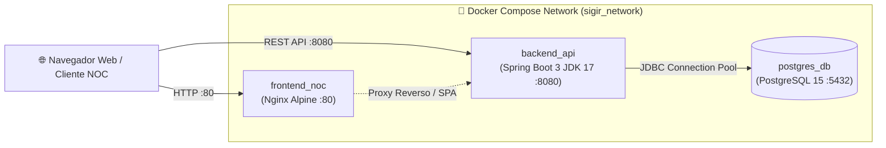

# 🐳 05_DESPLIEGUE_Y_SCRIPTS — Orquestación con Docker Compose

Infraestructura de contenedores para despliegue automatizado, reproducible y aislado del ecosistema **SIGIR - BCRP**.

---

## 🏗️ 1. Arquitectura de Servicios Orquestados

El archivo [`docker-compose.yml`](docker-compose.yml) orquesta 3 servicios interconectados a través de una red bridge interna (`sigir_network`):



1. **`postgres_db` (PostgreSQL 15 Alpine):**
   * Persistencia en volumen nombrado `postgres_data`.
   * Inicialización automática con `01_SCHEMA_DDL_POSTGRESQL.sql` y `02_SEED_DATA_INICIAL.sql`.
   * Puerto expuesto: `5432` (restringido a loopback por seguridad).
2. **`backend_api` (Java 17 / Spring Boot 3.2.3):**
   * Construcción multi-stage en [`Dockerfile_Backend`](Dockerfile_Backend).
   * Verificación de salud (`healthcheck`) contra endpoint de Actuator.
   * Dependencia condicionada: Espera que `postgres_db` esté saludable (`service_healthy`).
   * Puerto expuesto: `8080`.
3. **`frontend_noc` (Nginx Alpine):**
   * Servidor web estático ultraliviano configurado en [`Dockerfile_Frontend`](Dockerfile_Frontend).
   * Puerto expuesto: `80`.

---

## 🚀 2. Comandos de Despliegue en 1 Paso

### Iniciar todos los servicios en segundo plano:
```bash
docker compose up -d --build
```

### Verificar estado y salud de los contenedores:
```bash
docker compose ps
```

### Consultar logs en tiempo real:
```bash
docker compose logs -f backend_api
```

### Detener los servicios preservando los datos:
```bash
docker compose down
```

### Detener y purgar volúmenes (limpieza total):
```bash
docker compose down -v
```

