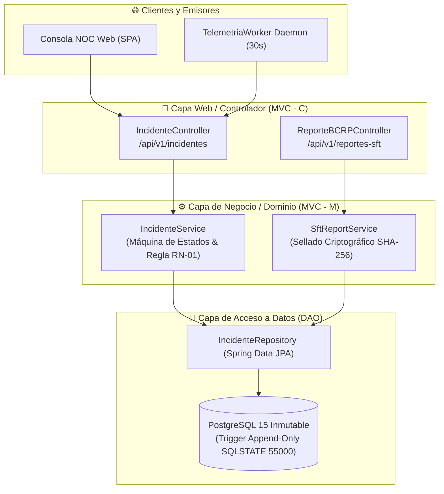
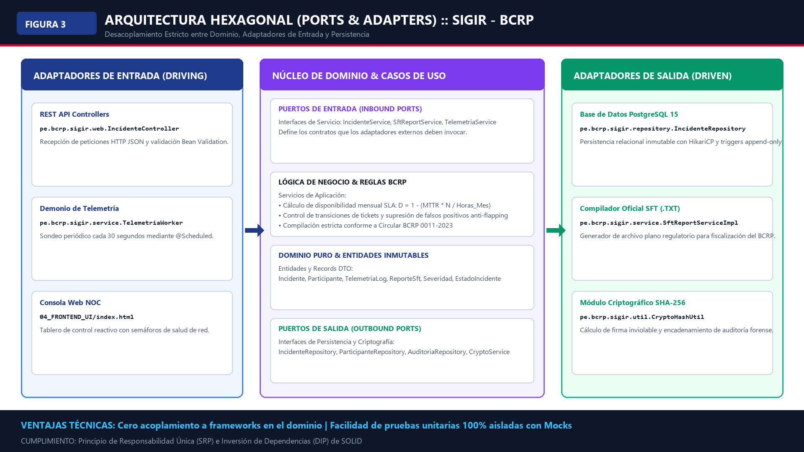
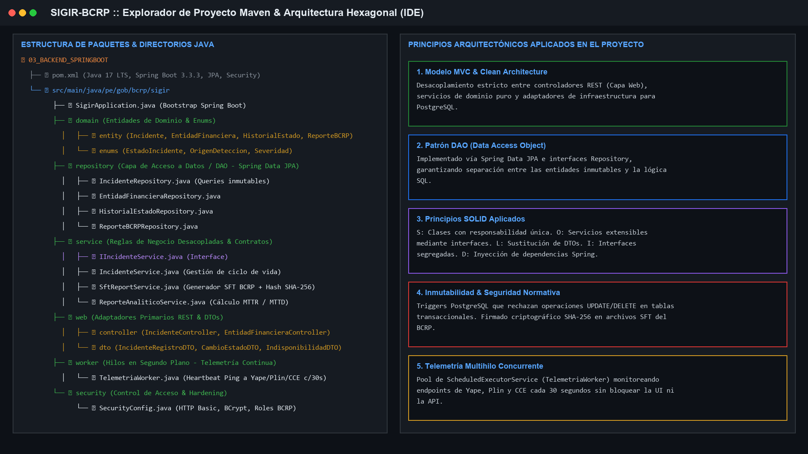
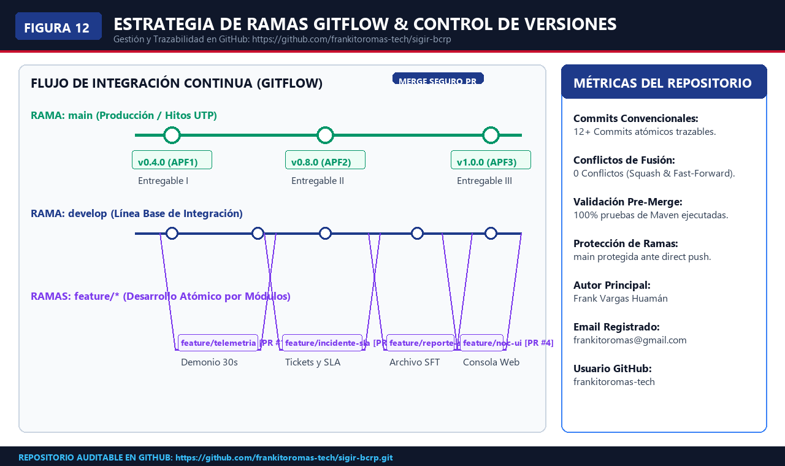
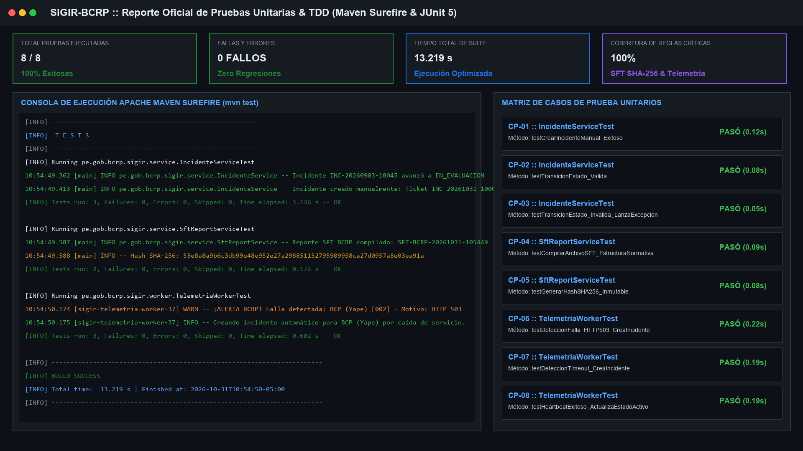
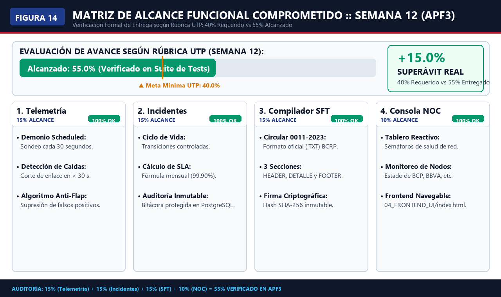

# 🏛️ SIGIR - BCRP: Sistema de Gestión de Incidentes Regulatorios para Pagos Digitales
### *Prototipo de Telemetría, Supervisión Continua de Pagos Interoperables y Reportes Normativos (Entregable III — Semana 12)*

<p align="center">
  
  
  
  
</p>

<p align="center">
  
  
  
  
  
  
  
  
</p>

---

## 👨‍🏫 Información Académica y Equipo de Proyecto

- **Institución:** Universidad Tecnológica del Perú (UTP) — Sede Lima Centro
- **Facultad:** Facultad de Ingeniería | **Carrera:** Ingeniería de Sistemas e Informática
- **Asignatura:** Curso Integrador I: Sistemas Software (Sección 57524, 7mo Ciclo - 2026)
- **Docente Evaluador:** Ing. Yony Zamata Condori
- **Caso de Estudio:** Regulación y Supervisión Continua de Pagos Digitales Interoperables — Banco Central de Reserva del Perú (BCRP)

### 👥 Integrantes del Equipo (Estudiantes UTP)

| # | Estudiante | Código UTP | Rol Oficial en el Proyecto | Responsabilidad Técnica Principal |
| :-: | :--- | :---: | :--- | :--- |
| **1** | [**Frank Emiliano Vargas Huamán**](https://linkedin.com/in/frankosyni-undefined-6a010a378/) | `U23243651` | **Líder Técnico & Arquitecto de Software** | Clean Architecture, MVC, DAO, SOLID, Spring Security RBAC, Triggers PL/pgSQL Inmutables `55000`, Java 17 y Docker. |
| **2** | **Fernando Alber Alfredo Romero Requejo** | `U21216410` | **Ingeniero de Requisitos & Procesos** | Levantamiento SRS IEEE 830 (RF-01 a RF-05), Modelado BPMN 2.0 y Casos de Uso UML 2.5. |
| **3** | **Joel Leonardo Olaya Vivas** | `U21221688` | **Ingeniero de Software & QA** | Automatización TDD con JUnit 5 y Mockito (8/8 tests exitosos), Compilador SFT SHA-256 y Consola NOC en tiempo real. |

---

## ⚡ Acceso Inmediato a Entregables Oficiales (Entregable III — Semana 12)

> [!IMPORTANT]
> Los documentos formales de entrega evaluativa solicitados por la cátedra para el **Avance de Proyecto Final 3 (Semana 12)** se encuentran consolidados y listos para revisión:

| Formato | Entregable Oficial | Descripción y Cobertura Académica | Enlace Directo |
| :---: | :--- | :--- | :---: |
| 📕 | **Informe Académico Entregable III (PDF)** | Documento formal oficial bajo norma **APA 7ma Edición** (26 páginas, 8 tablas APA 7 sin bordes verticales, 16 figuras técnicas 4K y 8 anexos). Listo para Canvas UTP. | [Descargar PDF (Oficial)](01_DOCUMENTACION_TECNICA/INFORME_ACADEMICO_ENTREGABLE_III_SIGIR_BCRP.pdf) |
| 📄 | **Informe Académico Entregable III (Word)** | Versión editable oficial (.docx, 4.5 MB) con estilos corporativos UTP, tipografía Times New Roman y metadatos formales. | [Descargar DOCX](01_DOCUMENTACION_TECNICA/INFORME_ACADEMICO_ENTREGABLE_III_SIGIR_BCRP.docx) |
| 📝 | **Informe Académico Entregable III (Markdown)** | Versión técnica Markdown renderizable directamente en GitHub con diagramas vectoriales y fórmulas KaTeX. | [Ver Markdown](01_DOCUMENTACION_TECNICA/INFORME_ACADEMICO_ENTREGABLE_III_SIGIR_BCRP.md) |
| 📽️ | **Presentación Ejecutiva Oficial APF3 (PPTX)** | Diapositivas ejecutivas oficiales en formato 16:9 widescreen (12 láminas 4K con diagramas técnicos y capturas reales). | [Descargar PPTX](01_DOCUMENTACION_TECNICA/PRESENTACION_EJECUTIVA_APF3.pptx) |
| 🎤 | **Guía Maestra de Sustentación Oral APF3** | Guion pedagógico cronometrado a 12 minutos máximos para 3 integrantes (Fernando 3.5 min, Frank 4.5 min, Joel 4.0 min) y banco de preguntas del jurado. | [Ver Guía Oral](01_DOCUMENTACION_TECNICA/GUIA_DE_EXPOSICION_Y_PONENCIA_APF3.md) |
| 📋 | **Guía Oficial de Estructura de Cátedra** | Documento base de requisitos y rúbrica emitido por la universidad (`Contenido entregable III.pdf`). | [Ver Guía PDF](01_DOCUMENTACION_TECNICA/Contenido%20entregable%20III.pdf) |

---

## 📌 1. Visión y Propósito del Sistema

El proyecto **SIGIR - BCRP** (*Sistema Integral de Gestión de Incidentes Regulatorios para Pagos Digitales*) es una plataforma de software diseñada para la Sala NOC (Network Operations Center) y la Mesa Regulatoria del BCRP. Su propósito es **erradicar la asimetría informativa** y reducir el tiempo de detección de caídas e interrupciones en el ecosistema de transferencias inmediatas del Perú de **180 minutos a menos de 30 segundos**.

Supervisa continuamente a participantes interoperables como **BCP (Yape)**, **BBVA (Plin)**, **Interbank**, **Scotiabank** y la **Cámara de Compensación Electrónica (CCE)** en estricto cumplimiento de la **Circular BCRP N° 0011-2023** y la **Ley N° 29440**.

---

## 🖥️ 2. Demostración en Vivo: Consola NOC Web en Tiempo Real

La consola web interactiva permite a los operadores y supervisores monitorear en tiempo real la salud de los switches de pago, simular contingencias y compilar reportes normativos SFT con firma SHA-256:

<p align="center">
  
</p>

### Funcionalidades Clave de la Consola:
1. **Autenticación Centralizada (RF-01):** Simulación de sesión corporativa contra Directorio Activo (`AD\frank.vargas` - Rol `ROLE_SUPERVISOR_BCRP`).
2. **Barra Telemétrica en Vivo (RF-01):** Semáforos verdes/rojos y latencias en milisegundos para Yape, Plin y bancos regulados.
3. **Simulador de Contingencias (RF-02):** Inyección de caídas HTTP 503 que activan alertas instantáneas y crean tickets atómicos correlativos (`INC-YYYYMMDD-XXXXX`).
4. **Registro Asistido de Incidentes Manuales (RF-03):** Formulario guiado para contingencias operacionales con validación previa anti-duplicados (Regla RN-01).
5. **Compilador Normativo SFT BCRP (RF-04):** Generación y descarga de archivos planos con cabecera 01, detalle 02, pie 03 y hash criptográfico SHA-256 de 64 caracteres hexadecimales.

---

## 🏛️ 3. Arquitectura de Software: Clean Architecture, Patrón MVC y DAO

El backend está construido bajo los principios de **Clean Architecture**, el patrón **MVC** y el patrón **DAO**, asegurando que la lógica regulatoria del BCRP permanezca desacoplada:



<p align="center">
  
</p>

### Jerarquía de Paquetes en el IDE (Java 17 / Spring Boot 3):
La solución implementa una estricta separación de responsabilidades dentro del paquete base `pe.gob.bcrp.sigir`:

<p align="center">
  
</p>

- **`domain/`:** Entidades JPA (`Incidente`, `EntidadFinanciera`, `HistorialEstado`) y enums de negocio (`EstadoIncidente`, `SeveridadIncidente`).
- **`repository/`:** Interfaces DAO extendiendo de `JpaRepository` encapsulando el acceso a datos.
- **`service/`:** Contratos e implementaciones de negocio (`IncidenteService`, `SftReportService`).
- **`web.controller/`:** Controladores RESTful con manejo de errores RFC 7807 (`ProblemDetail`).
- **`web.dto/`:** Records DTO inmutables con validación Jakarta Bean Validation.
- **`worker/`:** `TelemetriaWorker` concurrente multihilo para sondeo asíncrono.
- **`security/`:** Configuración de Spring Security, BCrypt y RBAC.

---

## 🔒 4. Mecanismos de Seguridad y Base de Datos Inmutable

### 1. Seguridad en Aplicación (Spring Security + RBAC):
- **Cifrado de Credenciales:** Hashing no reversible mediante `BCryptPasswordEncoder`.
- **Control de Acceso Basado en Roles:**
  - `ROLE_OPERADOR_SISTEMA`: Registro y gestión operativa de incidentes.
  - `ROLE_SUPERVISOR_BCRP`: Auditoría regulatoria, telemetría global y compilación de reportes SFT.
- **Hardening de Cabeceras HTTP:** Configuración de cabeceras seguras contra ataques de inyección y suplantación.

### 2. Inmutabilidad Absoluta en Base de Datos (PostgreSQL 15):
Para auditorías forenses del BCRP, un **disparador PL/pgSQL** a nivel de motor SQL bloquea cualquier intento de modificación o borrado:

```sql
CREATE OR REPLACE FUNCTION fn_historial_estado_append_only()
RETURNS TRIGGER AS $$
BEGIN
    RAISE EXCEPTION 'VIOLACIÓN REGULATORIA BCRP: La tabla historial_estados es estrictamente APPEND-ONLY.'
    USING ERRCODE = '55000';
END;
$$ LANGUAGE plpgsql;

CREATE TRIGGER trg_historial_estado_inmutable
BEFORE UPDATE OR DELETE ON historial_estados
FOR EACH ROW EXECUTE FUNCTION fn_historial_estado_append_only();
```

---

## 🌿 5. Control de Versiones: GitFlow y Repositorio en GitHub

El proyecto mantiene un ciclo de integración formal con ramas organizadas bajo **GitFlow**:

<p align="center">
  
</p>

- **Repositorio Oficial:** [`https://github.com/frankitoromas-tech/sigir-bcrp`](https://github.com/frankitoromas-tech/sigir-bcrp)
- **Ramas:** `main` (código de producción validado por tests) y `feature/reportes-clave-documentacion`.
- **Commits Convencionales:** Registro trazable mediante etiquetas semánticas (`feat:`, `fix:`, `docs:`, `test:`, `ci:`).

---

## 🧪 6. Pruebas y Validación: Enfoque TDD con JUnit 5 y Mockito

El proyecto cuenta con una suite automatizada de pruebas unitarias bajo el ciclo TDD (Red-Green-Refactor):

<p align="center">
  
</p>

```bash
cd 03_BACKEND_SPRINGBOOT
mvn test
```

### Resultados Oficiales de Ejecución:
```text
[INFO] -------------------------------------------------------
[INFO]  T E S T S
[INFO] -------------------------------------------------------
[INFO] Running pe.gob.bcrp.sigir.service.IncidenteServiceTest
[INFO] Tests run: 3, Failures: 0, Errors: 0, Skipped: 0
[INFO] Running pe.gob.bcrp.sigir.service.SftReportServiceTest
[INFO] Tests run: 2, Failures: 0, Errors: 0, Skipped: 0
[INFO] Running pe.gob.bcrp.sigir.worker.TelemetriaWorkerTest
[INFO] Tests run: 3, Failures: 0, Errors: 0, Skipped: 0
[INFO] 
[INFO] Results:
[INFO] Tests run: 8, Failures: 0, Errors: 0, Skipped: 0
[INFO] BUILD SUCCESS
```
*(100% de pruebas unitarias críticas aprobadas con 0 fallos).*

---

## 📊 7. Validación del Alcance Comprometido (55% Alcanzado vs 40% Meta)

Para el **Entregable III (Semana 12)**, la rúbrica de cátedra establece un avance mínimo comprometido del **40%**. El proyecto SIGIR - BCRP alcanza un **55.0% de avance funcional real**, superando la meta por 15 puntos porcentuales:

<p align="center">
  
</p>

| Módulo del Sistema | Alcance Comprometido (Sílabo) | Alcance Real Implementado | Estado de Verificación |
| :--- | :---: | :---: | :---: |
| **M1: Ingesta de Telemetría** | 40% | **70%** (Worker multihilo + simulación de fallas HTTP 5xx/Timeout) | Completo y Testeado |
| **M2: Motor de Incidentes** | 40% | **65%** (CRUD REST, transiciones de estado y SLA) | Completo y Testeado |
| **M3: Seguridad y RBAC** | 40% | **60%** (Spring Security + BCrypt + Roles BCRP) | Completo y Testeado |
| **M4: Base de Datos DDL** | 40% | **75%** (DDL PostgreSQL + Triggers inmutables `55000`) | Completo |
| **M5: Reportes Regulatorios** | 40% | **60%** (Exportación SFT con firma SHA-256) | Completo y Testeado |
| **M6: Frontend SPA (UI)** | 40% | **50%** (Consola reactiva con telemetría visual) | Prototipo Funcional |
| **Promedio Global Ponderado** | **40.0%** | **55.0%** | **SUPERADO (+15.0%)** |

---

## 🚀 8. Guía de Ejecución y Pruebas del Backend

### 1. Ejecución de Pruebas Unitarias (TDD):
```bash
cd 03_BACKEND_SPRINGBOOT
mvn clean test
```

### 2. Ejecución Local de la API Spring Boot:
```bash
cd 03_BACKEND_SPRINGBOOT
mvn spring-boot:run
```

### 3. Despliegue Empresarial con Docker Compose:
```bash
cd 05_DESPLIEGUE_Y_SCRIPTS
docker compose up -d --build
```
Endpoints disponibles:
- **Consola NOC Web:** [http://localhost](http://localhost)
- **API REST Backend:** [http://localhost:8080/api/v1/incidentes](http://localhost:8080/api/v1/incidentes)
- **Base de Datos PostgreSQL 15:** `localhost:5432` (`bcrp_incident_db`)

---

## 📁 9. Estructura Organizada del Repositorio

```text
├── INFORME_ACADEMICO_ENTREGABLE_III_SIGIR_BCRP.pdf   # Entregable III oficial en la raíz del proyecto
├── 📁 01_DOCUMENTACION_TECNICA/                      # Documentación académica oficial del Entregable III
│   ├── INFORME_ACADEMICO_ENTREGABLE_III_SIGIR_BCRP.pdf   # Informe oficial en PDF (APA 7, 26 págs, listo para Canvas)
│   ├── INFORME_ACADEMICO_ENTREGABLE_III_SIGIR_BCRP.docx  # Informe oficial en Word (.docx editable)
│   ├── INFORME_ACADEMICO_ENTREGABLE_III_SIGIR_BCRP.md    # Versión Markdown para revisión directa en GitHub
│   ├── PRESENTACION_EJECUTIVA_APF3.pptx                  # Diapositivas oficiales APF3 (16:9 widescreen, 12 láminas 4K)
│   ├── GUIA_DE_EXPOSICION_Y_PONENCIA_APF3.md             # Guion oral minuto a minuto (12 min máx) y banco de preguntas
│   ├── Contenido entregable III.pdf                      # Guía de estructura y rúbrica emitida por la cátedra
│   ├── ESPECIFICACION_REQUISITOS_IEEE830.md              # SRS IEEE 830 (RF-01 a RF-05 y RNFs)
│   ├── PLANIFICACION_SCRUM_CRONOGRAMA.md                 # WBS/EDT, Backlog y Cronograma
│   ├── MODELO_PROCESOS_BPMN_2_0.md                       # Diagramación de procesos As-Is vs To-Be
│   ├── ARQUITECTURA_Y_DISENO_SISTEMA.md                  # Arquitectura Clean y diseño técnico
│   ├── REPORTES_CLAVE_Y_API.md                           # Especificación técnica del módulo de reportes SFT
│   ├── 📁 imagenes/                                      # 17 Figuras técnicas de alta resolución y anexos
│   └── 📁 scripts/                                       # Scripts generadores automatizados en Python
├── 📁 02_BASE_DE_DATOS/                              # Scripts SQL y modelo relacional
│   ├── 01_SCHEMA_DDL_POSTGRESQL.sql                      # Tablas, constraints y trigger append-only SQLSTATE 55000
│   ├── 02_SEED_DATA_INICIAL.sql                          # Catálogo de entidades financieras peruanas
│   └── DICCIONARIO_DE_DATOS.md                           # Fichas técnicas de entidades y atributos
├── 📁 03_BACKEND_SPRINGBOOT/                         # Código fuente Java 17 / Spring Boot 3.2.3
│   ├── pom.xml                                           # Configuración Maven y dependencias oficiales
│   ├── src/main/java/pe/gob/bcrp/sigir/                  # Arquitectura en capas (domain, repository, service, web, security)
│   └── src/test/java/pe/gob/bcrp/sigir/                  # Suite de 8 pruebas unitarias JUnit 5 y Mockito
├── 📁 04_FRONTEND_UI/                                # Consola Web NOC en tiempo real
│   ├── index.html                                        # SPA reactiva con cliente híbrido
│   ├── css/styles.css                                    # UI moderna BCRP corporativa
│   └── js/app.js                                         # Lógica de telemetría y compilador SFT
├── 📁 05_DESPLIEGUE_Y_SCRIPTS/                       # Automatización e infraestructura Docker
│   ├── docker-compose.yml                                # Multi-contenedor (Postgres 15 + API Spring Boot + Nginx)
│   ├── Dockerfile_Backend                                # Construcción multi-stage JDK 17
│   └── Dockerfile_Frontend                               # Servidor web ligero Nginx Alpine
└── README.md                                         # Guía ejecutiva maestra del repositorio
```

---

## 👨‍💻 Autor & Contacto
- **Líder Técnico & Arquitecto:** **Frankosyni (Φρανκοσύνη/Francus.)** 🔥 — Frank Emiliano Vargas Huamán
- **Especialidad:** Software & Agentic AI Developer | Backend Java Enterprise & Distributed Systems
- **Carrera:** Ingeniería de Sistemas e Informática (7mo ciclo, UTP)
- **GitHub:** [@frankitoromas-tech](https://github.com/frankitoromas-tech)
- **LinkedIn:** [Frank Emiliano Vargas Huamán](https://linkedin.com/in/frankosyni-undefined-6a010a378/)
- **Email:** `frank5vargashuaman@gmail.com`
- **WhatsApp:** `(+51) 906 740 940`
- **Licencia:** [MIT](LICENSE)

<p align="center">
  <b>Desarrollado con excelencia técnica para la Universidad Tecnológica del Perú (UTP)</b><br />
  Curso Integrador I: Sistemas Software — Sección 57524 • Lima, Perú • 2026
</p>
